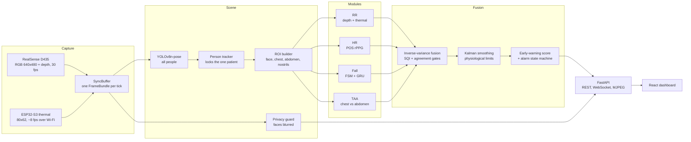

# VisionICU

Real-time, non-invasive, camera-based patient monitoring for ICU and IMCU environments.
Estimates Heart Rate, Respiratory Rate, Fall/Chair-Exit events, and Pain proxy
from video alone — no contact sensors attached to the patient.

VisionICU watches a seated or bed-bound patient with an Intel RealSense D435 (colour + depth)
and a low-cost ESP32-S3 thermal camera, computes vital signs on an edge device, and serves a
live web dashboard for the nursing team: vital signs with their signal quality, a
respiratory-cardiac early-warning score that explains itself, fall detection, breathing
synchrony, and escalating alarms.

> **Research prototype.** 

---

## Contents

- [What it measures](#what-it-measures)
- [How it works](#how-it-works)
- [Hardware](#hardware)
- [Modules](#modules)
- [Quick Start](#quick-start)
- [Model files](#model-files)
- [First session with the cameras](#first-session-with-the-cameras)
- [Commands](#commands)
- [Web dashboard](#web-dashboard)
- [Early-warning score and alarms](#early-warning-score-and-alarms)
- [Privacy](#privacy)
- [Configuration](#configuration)
- [API reference](#api-reference)
- [Project structure](#project-structure)
- [Scripts](#scripts)
- [Testing and CI](#testing-and-ci)
- [Deploying on the Jetson](#deploying-on-the-jetson)
- [Troubleshooting](#troubleshooting)
- [Development Sequence](#development-sequence)
- [Constraint Notes](#constraint-notes)
- [Roadmap and known limitations](#roadmap-and-known-limitations)
- [Related repositories](#related-repositories)
- [Acknowledgements](#acknowledgements)

---

## What it measures

| Signal | How | Output |
|---|---|---|
| **Respiratory rate (RR)** | Chest-depth motion from the D435 (spectral analysis), plus nostril temperature from the thermal camera (warm on exhale, cool on inhale) | breaths/min, signal quality, apnoea flag |
| **Heart rate (HR)** | Remote photoplethysmography (POS algorithm) on the facial skin colour | beats/min, signal quality |
| **Falls / chair exit** | YOLOv8 pose keypoints → kinematics + state machine + GRU classifier, confirmed by a hybrid gate | posture state, confirmed falls |
| **Breathing synchrony (TAA)** | Phase difference between chest and abdomen depth signals | paradoxical-breathing flag |
| **Pain proxy** | Facial action units → CPOT proxy (SynPAIN-trained) | *pending integration* |

Every number carries a **signal quality index (SQI)**. When a vital cannot be measured, the
system says so and why ("signal too weak", "sensors disagree") instead of guessing.

---

## How it works



1. **Capture.** The D435 delivers aligned colour and depth frames; the thermal camera is polled
   in the background, and each D435 frame is paired with the newest thermal frame (≤ 250 ms old).
2. **Scene.** Pose estimation finds every person in view. A one-time chair calibration tells the
   tracker which person is the patient, and it stays locked on them while staff come and go.
   The patient's skeleton defines the face, chest, abdomen and nostril regions.
3. **Modules.** Each vital-sign module turns its region into a `Measurement`
   (`value`, `sqi`, `source`, `latency_ms`, `meta`). `value = None` means "cannot measure right now".
4. **Fusion.** Estimates of the same vital are combined by inverse-variance weighting; low-quality
   paths are dropped, and paths that disagree produce no number rather than an average. A Kalman
   filter applies physiological rate-of-change limits, trends are computed over 5/15/60/240 min,
   and the early-warning score drives an alarm state machine.
5. **Serving.** A FastAPI server streams everything to the browser dashboard.

---

## Hardware
- Intel RealSense D435 (RGB + Depth + IR)
- ESP32-S3 Thermal Camera (inference-only RR signal — not used in training)
- Jetson Orin Nano Super 8GB (edge deployment)

| Device | Settings used | Notes |
|---|---|---|
| Intel RealSense D435 | RGB 640×480 @ 30 fps (bgr8), depth 424×240 @ 30 fps aligned to RGB, exposure 156, white balance 4600 | Mount 1.5–2.0 m from the patient at chest-to-face height, tilted 10–30° down |
| Waveshare ESP32-S3 thermal camera | 62×80 px, int16 centi-°C over HTTP at `http://192.168.4.1/thermal/frame` | Join its Wi-Fi access point; the endpoint is auto-discovered |
| NVIDIA Jetson Orin Nano Super 8GB | JetPack, CUDA | Edge deployment target; a laptop works for development |

---

## Modules

### What runs today

| Module | Method in the live pipeline | Weights needed at runtime | Status |
|--------|-----------------------------|---------------------------|--------|
| Respiratory Rate | Welch spectrum of chest depth; nostril-temperature path from the thermal camera; apnoea detector | none | Running |
| Heart Rate | POS rPPG on skin-masked face colour | none | Running |
| Fall Detection | YOLOv8n-pose → kinematics → state machine + GRU classifier → hybrid confirmation gate | `yolov8n-pose.pt`, `fall_gru_pseudo.pt` | Running |
| Breathing synchrony (TAA) | Hilbert phase difference, chest vs abdomen depth | none | Running |
| Pain Assessment | — | — | Pending: `src/modules/pain.py` is a scaffold |

The signal-processing paths are primary because they are transparent and tunable. The learned
estimators below are kept in the repository and stay off until they are independently validated
on this camera setup.

### Trained weights (model registry)

| Module | Weights | Status |
|--------|---------|--------|
| Respiratory Rate | `rr_tcn_finetuned.pth` | Locked |
| Heart Rate | `hr_efficientphys_finetuned.pth` | Locked |
| Fall Detection | `fall_model_finetuned.pt` | Locked |
| Pain Assessment | `pain_deepmlp_synpain.pth` | SynPAIN only; UNBC/BioVid pending |

Full registry from `models/*/README.md` (paths in `config/models.yaml`). These learned paths are
**not loaded by the live pipeline yet**:

| File | Folder | Module | Trained on | Reported result |
|---|---|---|---|---|
| `rr_tcn_lbrdic.pth` | `public/` | RR | LBRD-IC | MAE ≤ 3.84 bpm |
| `hr_efficientphys_ubfc.pth` | `public/` | HR | UBFC-rPPG | MAE ≤ 3 bpm on PURE |
| `fall_model_public.pt` | `public/` | Fall | UR Fall + UP-Fall | |
| `pain_xgboost_synpain.joblib` | `public/` | Pain | SynPAIN | 75.4 % acc, AUC 0.841 |
| `rr_tcn_finetuned.pth` | `finetuned/` | RR | own D435 clips | Locked |
| `hr_efficientphys_finetuned.pth` | `finetuned/` | HR | own D435 clips | Locked |
| `fall_model_finetuned.pt` | `finetuned/` | Fall | own clips | Locked |
| `pain_deepmlp_synpain.pth` | `finetuned/` | Pain | SynPAIN | 77.1 % acc, AUC 0.850 |
| `pain_temporal_tcn.pth` | `finetuned/` | Pain | UNBC/BioVid | Pending |
| `*.onnx` | `onnx/` | RR, HR, Pain | exports for TensorRT | via `scripts/export_to_onnx.py` (pending) |

---

## Quick Start
```bash
pip install -r requirements.txt
cd frontend && npm ci && npm run build && cd ..   # build the web dashboard once
# Place weight files in models/public/ and models/finetuned/ (see README files there)
python main.py                   # start monitor + dashboard -> http://127.0.0.1:8000
```

No camera or weights yet? `python main.py --demo` runs four **simulated** beds (stable,
deteriorating, fall, breathing problems), clearly labelled as simulated in the UI. The
simulated measurements still go through the real fusion, early-warning and alarm code.

### Step by step

**Prerequisites:** Python 3.10 or newer (tested on 3.10 and 3.13), Node.js 20 or newer, Git.

```bash
# 1. Get the code
git clone https://github.com/MohnishVik/ICU-Vision-Monitor.git
cd ICU-Vision-Monitor

# 2. Create a virtual environment
python -m venv .venv
source .venv/bin/activate          # Windows: .venv\Scripts\activate

# 3. Install Python dependencies
pip install -r requirements.txt
#    If pyrealsense2 has no wheel for your platform (e.g. Jetson), build librealsense
#    with Python bindings from source — see deploy/setup_jetson.sh.

# 4. Build the dashboard (once, and again after frontend changes)
cd frontend
npm ci
npm run build
cd ..

# 5. Try it without hardware
python main.py --demo
```

Open **http://127.0.0.1:8000**. For the real cameras, add the model files below and run
`python main.py`.

---

## Model files

Only two files are required at runtime, both in **`models/public/`**:

```
models/public/
├── yolov8n-pose.pt          # Ultralytics YOLOv8n-pose (COCO pretrained, never retrained)
├── fall_gru_pseudo.pt       # fall GRU classifier (primary)
└── fall_gru_pseudo_e1.pt    # fall GRU classifier (optional fallback)
```

| File | Used for | If it is missing |
|---|---|---|
| `yolov8n-pose.pt` | Finding and tracking the patient, face blurring, fall keypoints, the nostril region | Pose, face blur and fall switch off; RR and HR fall back to fixed regions |
| `fall_gru_pseudo.pt` | Fall classification (from the [Fall_Detection](https://github.com/MohnishVik/Fall_Detection) project, originally `best_fall_gru.pt`) | The fallback is tried; with neither, fall detection switches off |
| `fall_gru_pseudo_e1.pt` | Fallback fall weights (originally `best_model.pt`) | Nothing changes while the primary exists |

- RR, HR and TAA need no weights. `models/finetuned/` and `models/onnx/` are not read yet.
- The app does not download the pose weights automatically; place the file yourself.
- Weight files are git-ignored. Never commit them.
- The **System** page shows which modules are running and, for any that are not, the exact path
  that was checked.

---

## First session with the cameras

1. Connect the D435 by USB 3 and join the thermal camera's Wi-Fi network.
2. Optional checks: `python scripts/diagnose_cameras.py` shows both streams;
   `python scripts/scan_esp32.py` finds the thermal endpoint.
3. Start the monitor: `python main.py`, then open http://127.0.0.1:8000.
4. **Set up the chair** (every session): open the bed and click the four corners of the seat in
   any order. Drag a corner to adjust, then **Start monitoring**. The seat polygon decides who the
   patient is and gives the fall detector its reference depth.
   Next time, `python main.py --reuse-calibration` skips this if nothing moved.
5. **Align the thermal camera** (once per camera mount): on the bed page choose
   **Align with colour camera**. Hold a mug of hot water at about the patient's distance, take a
   snapshot, and click the mug in the colour image and then in the thermal image. Repeat at
   4–6 spots spread across the view and save. The overlay check should show warm areas sitting on
   the matching objects. After this, RR reads the temperature at the nostrils instead of the
   warmest spot. (Faces are blurred in the colour image, so a warm object is the marker.)

---

## Commands

| Command | What it does |
|---|---|
| `python main.py` | D435 camera mode. Open the dashboard and click the 4 chair corners to start. |
| `python main.py --demo` | Simulated ward, no hardware needed. |
| `python main.py --reuse-calibration` | Skip the click if this bed was calibrated before. |
| `python main.py --host 0.0.0.0` | Reachable from a nurse-station PC on the same network. |
| `python main.py --hud` | Legacy OpenCV window (`scripts/run_monitor.py`). |
| `cd frontend && npm run dev` | Live UI development on :5173 (proxies to the server on :8000). |

Other `main.py` options: `--port` (default 8000), `--patient-id` (default `bed-1`), `--label`
(default `Bed 1`), `--config-dir` (default `config`), `--fps` (default 30), `--frontend-dir`
(default `frontend/dist`).

---

## Web dashboard
- **Ward view:** one tile per bed, quiet when stable and loud only on deviation. Fixed bed order.
- **Bed view:** live face-blurred video with pose/chair overlay, HR and RR with signal quality,
  early-warning sub-score with a plain-language explanation ("RR 16→26 over 40 min"),
  alarms with acknowledge, 5 min to 4 h trends against NEWS2 bands, falls, breathing
  synchrony, and which sensor path produced each number.
- **Chair setup** happens in the browser: click the four seat corners on a still frame.
- **Thermal camera (ESP32):** live heatmap with °C on hover and the breath-temperature waveform
  RR is computed from. A one-time **alignment** (bed page → "Align with colour camera": click a
  mug of hot water in both images at 4–6 spots) maps thermal pixels onto the colour image, so RR
  reads the temperature at the nostrils instead of the warmest spot. Saved per bed in
  `config/sessions/thermal_<bed>.json`; a fixed `homography_matrix` in `camera.yaml` also works.
- **Alarms** escalate log → dashboard → chime → phone (config/ews_rules.yaml), are held back
  while staff are at the bedside, and falls stay up until acknowledged.
- **Honesty rules:** a vital that cannot be measured shows "—" with the reason; a reading older
  than 5 s is marked stale; missing hardware or weights switch only that module off (see /system).
- **Privacy:** faces are blurred in the stream, nothing is recorded by default
  (`privacy.allow_debug_capture` in config/signal.yaml enables de-identified fall snapshots).
- **System page:** server health, every module's state with the reason, frame rate and latency.
- **Alarm sound:** browsers block audio until you allow it — click **Turn on alarm sound** once.
- **Design:** a dark "night ward" theme, bundled fonts (works offline), keyboard accessible,
  reduced-motion aware, phone-sized layouts. HR/RR chart colours are checked for colour-vision
  deficiency.

---

## Early-warning score and alarms

The score follows NEWS2 bands for the two parameters the camera measures (`config/ews_rules.yaml`):

| Sub-score | 3 | 1 | 0 | 1 | 2 | 3 |
|---|---|---|---|---|---|---|
| **RR** (br/min) | ≤ 8 | 9–11 | 12–20 | | 21–24 | ≥ 25 |
| **HR** (bpm) | ≤ 40 | 41–50 | 51–90 | 91–110 | 111–130 | ≥ 131 |

| Total | Level | Action |
|---|---|---|
| 0–1 | green | routine monitoring |
| 2–4 | amber | increased monitoring |
| ≥ 5 | red | urgent clinical review |

- **Partial by design:** this is a respiratory-cardiac sub-score, not full NEWS2 (no SpO₂,
  temperature, blood pressure or consciousness). A missing vital is reported as missing, never
  scored as normal.
- **Event alarms:** a confirmed fall or apnoea is high priority; paradoxical breathing is medium.
- **Escalation:** `log_only` → `dashboard_highlight` (10 s) → `chime` (30 s) → `phone_push` (60 s).
- **Dwell and hysteresis:** an early-warning condition must last 1.5 s to alarm (falls, apnoea
  and paradoxical breathing are already sustained inside their modules), and any alarm must be
  gone for 5 s to clear.
- **Staff present** (2 or more other people in view): alarms are logged without sound.
- **Falls latch** until a nurse acknowledges them.
- **Explanations:** every alarm says why, e.g. *"RR 16→26 over 40 min. HR 88→112 over 40 min.
  Suggest urgent clinical assessment."*
- The target is 3 or fewer sounded alerts per nurse per shift; the dashboard shows the count.

---

## Privacy

- **No subject data is stored.** Vital signs are numbers; frames are processed in memory only.
- **Faces are blurred** in the live stream for every detected person (patient and staff).
- **Nothing is recorded** unless `privacy.allow_debug_capture: true` is set in `config/signal.yaml`.
  Even then only de-identified fall snapshots are written to `debug_captures/`, which is pruned
  by age and count and git-ignored.
- Per-session calibration files (`config/sessions/*.json`) are git-ignored.
- By default the server listens on `127.0.0.1` only. Use `--host 0.0.0.0` only on a trusted
  network; there is no login yet.

---

## Configuration

| File | Purpose |
|---|---|
| `config/camera.yaml` | D435 streams, **locked exposure and white balance**, thermal camera address, sync tolerance, optional thermal `homography_matrix` |
| `config/signal.yaml` | Signal-processing windows, frequency bands, quality gates, apnoea and TAA thresholds, fall-detector parameters, optional `privacy` and `scene` blocks |
| `config/ews_rules.yaml` | Early-warning bands, levels, alarm dwell, staff suppression, escalation stages |
| `config/models.yaml` | Model registry, module toggles, inference `device` (`cuda` on Jetson, `cpu` for laptop dev; pose falls back to CPU automatically when CUDA is unavailable), `use_onnx` |
| `config/recording.yaml` | Reference only: the original recording protocol, kept for paper reproducibility |
| `config/sessions/` | Saved chair calibrations and thermal alignments (created at runtime, git-ignored) |

Values marked `TUNE` in `signal.yaml` are starting points to adjust on your own recordings.
`rr.legacy_offline` holds the offline settings that reproduce the 1.88 BrPM paper result
(consumed by `training/eval.py`, which is still a scaffold).

---

## API reference

All REST endpoints are under `/api` (interactive docs at `/docs` while the server runs).

| Method | Path | Description |
|---|---|---|
| GET | `/health` | Module liveness and stale-value check |
| GET | `/patients` | Active patient list and current states |
| GET | `/patients/{id}/vitals` | Latest snapshot (vitals, EWS, alarms, scene) |
| GET | `/patients/{id}/history` | Time series for trend charts (`?minutes=&max_points=`) |
| POST | `/patients/{id}/ack` | Acknowledge an alarm (`{"alarm_id": int \| null}`) |
| GET | `/patients/{id}/calibration` | Chair calibration status |
| GET | `/patients/{id}/calibration/frame` | Still JPEG (faces blurred) to click the corners on |
| POST | `/patients/{id}/calibration` | `{"corners": [[x,y] ×4], "label": "chair" \| "bed"}` |
| POST | `/patients/{id}/calibration/reuse` | Load this bed's last saved calibration |
| DELETE | `/patients/{id}/calibration` | Clear (re-calibrate) |
| GET | `/patients/{id}/thermal` | Thermal grid (centi-°C), breathing region, breath trace, alignment |
| GET | `/patients/{id}/thermal/registration` | Thermal ↔ colour alignment status |
| POST | `/patients/{id}/thermal/registration` | `{"pairs": [{"rgb": [x,y], "thermal": [x,y]}, ...]}` (≥ 4) |
| DELETE | `/patients/{id}/thermal/registration` | Remove the alignment (back to the warmest spot) |
| POST | `/patients/{id}/thermal/snapshot` | Freeze a colour + thermal pair for marking points |
| GET | `/patients/{id}/thermal/snapshot/{sid}/rgb.jpg` | The frozen colour frame |
| GET | `/patients/{id}/thermal/overlay.jpg` | Colour frame with the aligned thermal image on top |
| GET | `/patients/{id}/frame.jpg` | Latest frame (faces blurred) |
| GET | `/patients/{id}/stream.mjpg` | Live MJPEG (faces blurred) |

WebSockets: `/ws/stream/{id}` pushes the full patient snapshot (≤ 4 Hz); `/ws/ward` pushes a
summary of every bed (1 Hz). Every `Measurement` has the shape
`{value, sqi, ts, source, latency_ms, meta}`, and stale values are flagged, never shown as live.

---

## Project structure

```
ICU-Vision-Monitor/
├── main.py                    # entry point: monitor engine + web dashboard
├── config/                    # camera, signal, EWS, model and recording settings
├── models/                    # weight files (git-ignored): public/, finetuned/, onnx/
├── src/
│   ├── types.py               # shared contracts: Measurement, FrameBundle, ROIBundle
│   ├── capture/               # D435 stream, ESP32 thermal stream, SyncBuffer
│   ├── scene/                 # chair calibration, pose, patient tracker, ROIs,
│   │                          # privacy guard, thermal-to-colour registration
│   ├── modules/               # rr.py, hr.py, fall.py, taa.py, pain.py (scaffold)
│   ├── fusion/                # inverse-variance fusion, Kalman, trends, EWS + alarm FSM
│   └── serving/               # background engines (camera + demo), REST, WebSockets
├── frontend/                  # React + TypeScript + Tailwind + Recharts dashboard (Vite)
├── scripts/                   # camera diagnostics, ESP32 scanner, legacy HUD, eval/export
├── training/                  # training and evaluation scaffolds
├── notebooks/                 # RR, HR, fall and pain debugging; paper figures
├── tests/                     # pytest suite
├── deploy/                    # Jetson setup script and systemd service
└── .github/workflows/ci.yml   # CI: leakage check, fusion + web tests, frontend build
```

---

## Scripts

| Script | What it does | Status |
|---|---|---|
| `scripts/diagnose_cameras.py` | Live D435 + thermal check before a session (`--d435-only`, `--thermal-only`) | Ready |
| `scripts/scan_esp32.py` | Finds the thermal camera's active HTTP endpoint (`--ip 192.168.4.1`) | Ready |
| `scripts/run_monitor.py` | Legacy single-window OpenCV monitor (`python main.py --hud`) | Ready |
| `scripts/eval_weights.py` | Weight sanity check: RR MAE ≤ 3.84 bpm (LBRD-IC), HR MAE ≤ 3 bpm (UBFC), Fall recall ≥ 90 % (UR-Fall), Pain acc ≥ 75 % (SynPAIN) | Scaffold |
| `scripts/export_to_onnx.py` | `.pth` → ONNX for TensorRT, validated within 0.1 bpm | Scaffold |

---

## Testing and CI

```bash
pip install -r requirements-dev.txt
pytest
```

The suite covers EWS scoring, fusion, Kalman, trends and alarms; the web API in demo mode and
in camera mode with no hardware attached; live MJPEG streaming; thermal-to-colour alignment;
and RR read at the nostrils.

GitHub Actions runs on every push and pull request:

| Job | Checks |
|---|---|
| `leakage-check` | No subject appears in both training and test splits (blocks the merge) |
| `fusion-and-web` | EWS, fusion, thermal and API tests on Python 3.10, without torch or camera drivers |
| `frontend-build` | `npm ci` + strict TypeScript + production build |

---

## Deploying on the Jetson

```bash
bash deploy/setup_jetson.sh          # swap, max performance mode, dependencies (asks for sudo itself)
```

1. Build `pyrealsense2` from source for the Jetson (librealsense with Python bindings).
2. Copy the model files into `models/public/`.
3. Build the dashboard: `cd frontend && npm ci && npm run build`.
4. Keep `device: "cuda"` in `config/models.yaml`.
5. Install the service so the monitor starts on boot:
   ```bash
   sudo cp deploy/visionicu.service /etc/systemd/system/
   sudo systemctl daemon-reload
   sudo systemctl enable --now visionicu
   journalctl -u visionicu -f        # logs
   ```
   The service runs `python3 main.py` from `/home/jetson/icu-vision-monitor`; edit
   `WorkingDirectory` if your path differs, and add `--host 0.0.0.0` to `ExecStart` for access
   from another PC.
6. Open the dashboard on the Jetson's monitor in a browser (kiosk mode works well).

---

## Troubleshooting

| You see | Do this |
|---|---|
| "Camera not connected" with `No module named 'pyrealsense2'` | Install `pyrealsense2`, or run `python main.py --demo` to explore without hardware |
| "Could not open the D435" | Use a USB 3 port and cable; close other apps using the camera; it retries every 5 s |
| Pose tracking "Not available: Weights not found" | Put `yolov8n-pose.pt` in `models/public/` and make sure `ultralytics` is installed |
| Fall detection "Not available: Weights missing" | Put `fall_gru_pseudo.pt` in `models/public/` |
| "Thermal camera offline" | Power the ESP32, join its Wi-Fi, run `python scripts/scan_esp32.py`; RR continues from depth alone |
| Thermal panel says "Not aligned yet" | Run the one-time alignment from the bed page |
| "Face blur unavailable: pose model not loaded" | Add the pose weights; blurring needs the face keypoints |
| Page says "The dashboard has not been built yet" | `cd frontend && npm ci && npm run build` |
| Port 8000 already in use | `python main.py --port 8080` |
| No alarm sound | Click **Turn on alarm sound** in the top bar once per browser session |
| Pose is slow on a laptop | Expected on CPU; it uses CUDA automatically when available |

---

## Development Sequence
1. `src/types.py` — shared contracts (done — scaffold in place)
2. `config/` — all YAML configs (done)
3. `src/capture/` — D435 + thermal streams
4. `src/scene/` — privacy + scene understanding
5. `src/modules/rr.py` — RR (start here — paste existing code)
6. `src/modules/hr.py` — HR
7. `src/modules/fall.py` — Fall
8. `src/modules/pain.py` — Pain
9. `src/fusion/` + `src/serving/` — EWS + dashboard

| Step | Status |
|---|---|
| 1. `src/types.py` | Done |
| 2. `config/` | Done |
| 3. `src/capture/` | Done |
| 4. `src/scene/` | Done (calibration, pose, tracker, ROIs, privacy, thermal registration) |
| 5. `src/modules/rr.py` | Done (depth + thermal paths, apnoea) |
| 6. `src/modules/hr.py` | Done (POS) |
| 7. `src/modules/fall.py` | Done (kinematics, FSM, GRU, hybrid gate) |
| 8. `src/modules/pain.py` | Pending |
| 9. `src/fusion/` + `src/serving/` | Done (EWS, alarms, dashboard) |

---

## Constraint Notes
- Auto-exposure is locked in `config/camera.yaml`. Never change exposure/WB values.
- Thermal was NOT used in RR training. TCN input is 2-channel [flow, depth] only.
- All subject video weights are locked. Do not retrain.
- Always report MAE + coverage together. Never bare MAE.

---

## Roadmap and known limitations

- **Pain module:** implement facial action-unit extraction (MediaPipe now, OpenFace later) and the
  SynPAIN models; UNBC/BioVid fine-tuning pending.
- **Learned estimators:** validate the RR/HR learned paths against the signal-processing paths on
  recordings with a reference signal before enabling them; implement `eval_weights.py`.
- **ONNX/TensorRT:** implement `export_to_onnx.py` and the `use_onnx` path for the Jetson.
- **Training scripts** in `training/` are scaffolds.
- **Thermal path** has been exercised with simulated frames; validate it on the physical ESP32.
  At much larger distances than the configured mount, the breathing spot may shrink below one
  thermal pixel.
- **Early-warning score** covers RR and HR only.
- **Access control:** add authentication before exposing the dashboard beyond a trusted network.

---

## Related repositories

- [HR_RR](https://github.com/MohnishVik/HR_RR) — HR/RR evaluation and live-monitor scripts, recording tools
- [Camera_Configurations](https://github.com/MohnishVik/Camera_Configurations) — D435 and thermal camera test scripts
- [Fall_Detection](https://github.com/MohnishVik/Fall_Detection) — the fall-detection GRU, feature extractor and state machine ported into `src/modules/fall.py`

---

## Acknowledgements

- POS rPPG: Wang et al., *Algorithmic Principles of Remote PPG*, IEEE TBME 2017.
- Pose estimation: [Ultralytics YOLOv8](https://github.com/ultralytics/ultralytics) (COCO keypoints).
- Datasets used for the trained weights: LBRD-IC, UBFC-rPPG, PURE, UR Fall, UP-Fall, SynPAIN.
- Early-warning bands: Royal College of Physicians, *National Early Warning Score (NEWS) 2*.

Author: **Mohnish S** ([@MohnishVik](https://github.com/MohnishVik))
