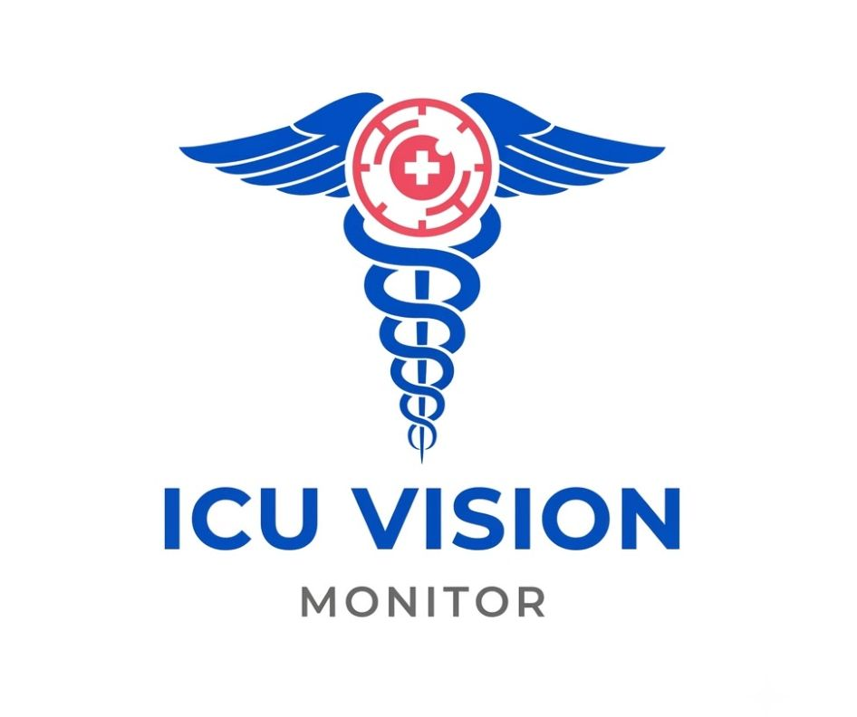
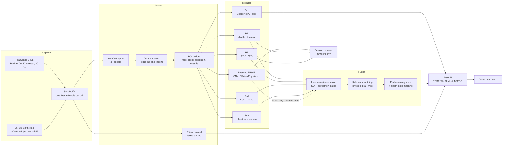

<p align="center"></p>

# VisionICU

[](https://github.com/MohnishVik/ICU-Vision-Monitor/actions/workflows/ci.yml)

Real-time, non-invasive, camera-based patient monitoring for ICU and IMCU environments.
Estimates Heart Rate, Respiratory Rate, Fall/Chair-Exit events, and Pain proxy
(an experimental pain-expression probability) from video alone — no contact sensors attached to the patient.

VisionICU watches a seated or bed-bound patient with an Intel RealSense D435 (colour + depth)
and a low-cost ESP32-S3 thermal camera, computes vital signs on an edge device, and serves a
live web dashboard for the nursing team: vital signs with their signal quality, a
respiratory-cardiac early-warning score that explains itself, fall detection, breathing
synchrony, and escalating alarms. A built-in record-and-compare workflow scores every
estimator, including the experimental learned models, against reference values you trust.

> **Research prototype, not a certified medical device.** It does not replace a bedside monitor
> or clinical judgement.

---

## Contents

- [What it measures](#what-it-measures)
- [How it works](#how-it-works)
- [Hardware](#hardware)
- [Modules](#modules)
- [Quick Start](#quick-start)
- [Model files](#model-files)
- [First session with the cameras](#first-session-with-the-cameras)
- [Commands](#commands)
- [Web dashboard](#web-dashboard)
- [Recording and comparing estimators](#recording-and-comparing-estimators)
- [Early-warning score and alarms](#early-warning-score-and-alarms)
- [Privacy](#privacy)
- [Configuration](#configuration)
- [API reference](#api-reference)
- [Project structure](#project-structure)
- [Scripts](#scripts)
- [Testing and CI](#testing-and-ci)
- [Deploying on the Jetson](#deploying-on-the-jetson)
- [Troubleshooting](#troubleshooting)
- [Development Sequence](#development-sequence)
- [Constraint Notes](#constraint-notes)
- [Roadmap and known limitations](#roadmap-and-known-limitations)
- [Related repositories](#related-repositories)
- [Acknowledgements](#acknowledgements)

---

## What it measures

| Signal | How | Output |
|---|---|---|
| **Respiratory rate (RR)** | Chest-depth motion from the D435 (spectral analysis), plus nostril temperature from the thermal camera (warm on exhale, cool on inhale) | breaths/min, signal quality, apnoea flag |
| **Heart rate (HR)** | Remote photoplethysmography (POS algorithm) on the facial skin colour | beats/min, signal quality |
| **Falls / chair exit** | YOLOv8 pose keypoints → kinematics + state machine + GRU classifier, confirmed by a hybrid gate | posture state, confirmed falls |
| **Breathing synchrony (TAA)** | Phase difference between chest and abdomen depth signals | paradoxical-breathing flag |
| **Pain proxy** | MobileNetV3-Small on the face crop, trained on SynPAIN (`SynPain.ipynb`) | probability of a pain expression; **experimental, never alarms** |
| **Learned RR / HR** | 1-D CNNs (LBRD-IC; D435 fine-tune) and EfficientPhys (UBFC-rPPG), each fed exactly its training input | shown and logged beside the signal-processing values; LBRD-IC CNN and EfficientPhys are **fused as secondary paths** (dropped when they disagree), the D435 CNN is shown only; **experimental** |

Every number carries a **signal quality index (SQI)**. When a vital cannot be measured, the
system says so and why ("signal too weak", "sensors disagree") instead of guessing.

---

## How it works



1. **Capture.** The D435 delivers aligned colour and depth frames; the thermal camera is polled
   in the background, and each D435 frame is paired with the newest thermal frame (≤ 250 ms old).
2. **Scene.** Pose estimation finds every person in view. A one-time chair calibration tells the
   tracker which person is the patient, and it stays locked on them while staff come and go.
   The patient's skeleton defines the face, chest, abdomen and nostril regions.
3. **Modules.** Each vital-sign module turns its region into a `Measurement`
   (`value`, `sqi`, `source`, `latency_ms`, `meta`). `value = None` means "cannot measure right now".
4. **Fusion.** Estimates of the same vital are combined by inverse-variance weighting; low-quality
   paths are dropped, and paths that disagree produce no number rather than an average. A Kalman
   filter applies physiological rate-of-change limits, trends are computed over 5/15/60/240 min,
   and the early-warning score drives an alarm state machine. Learned estimators and pain are
   shown beside the fused values and never reach the alarms unless you enable them.
5. **Serving.** A FastAPI server streams everything to the browser dashboard.

---

## Hardware
- Intel RealSense D435 (RGB + Depth + IR)
- ESP32-S3 Thermal Camera (inference-only RR signal — not used in training)
- Jetson Orin Nano Super 8GB (edge deployment)

| Device | Settings used | Notes |
|---|---|---|
| Intel RealSense D435 | RGB 640×480 @ 30 fps (bgr8), depth 424×240 @ 30 fps aligned to RGB, exposure / gain / white balance metered once at startup and then locked ([below](#camera-exposure)) | Mount 1.5–2.0 m from the patient at chest-to-face height, tilted 10–30° down |
| Waveshare ESP32-S3 thermal camera | 62×80 px, int16 centi-°C over HTTP at `http://192.168.4.1/thermal/frame` | Join its Wi-Fi access point; the endpoint is auto-discovered |
| NVIDIA Jetson Orin Nano Super 8GB | JetPack, CUDA | Edge deployment target; a laptop works for development |

### Camera exposure

Exposure is how long the camera's shutter stays open for each frame. Too short and a well-lit room
still looks dark; too long and movement smears. A camera on *auto* keeps nudging this up and down,
and every nudge makes the whole picture slightly brighter or darker. The heart-rate method looks for
a tiny, rhythmic change in skin colour, so it would read those nudges as heartbeats. That is why
exposure is never left on auto while monitoring.

`config/camera.yaml` → `d435.exposure_mode` picks how the fixed value is chosen:

| Mode | What happens at startup | Use it when |
|---|---|---|
| `auto_lock` (default) | Auto-exposure and auto white balance run for `auto_lock_settle_s` (2.5 s) and the brightness and red/blue balance they produce are measured. Auto is switched off and the same picture is rebuilt by hand: exposure, then gain, then (in a dim room) gamma and brightness are stepped until the frame is as bright as auto made it, and white balance is bisected until the colour matches. Those values are frozen for the whole run (about 7 s at startup) | Lighting differs between sessions (day, night, lamp on) |
| `fixed` | `locked_exposure` (0.1 ms units), `locked_gain` and `locked_white_balance` are written directly | You need byte-identical settings across recordings |

Why measure instead of asking the camera? On Windows without the RealSense metadata driver
patch the camera never reports what auto chose (it keeps answering 156), and in a dim room its
auto mode also applies an internal boost no manual setting exposes, which is why gamma and
brightness may be raised. Set `target_luma` to choose a brightness yourself.

Exposure is capped at one frame period (33.3 ms at 30 fps) so the frame rate never drops, and
`auto_exposure_priority` is turned off for the same reason. The locked values are printed at
startup. The D435-trained respiratory model reads depth, which the colour exposure does not affect,
and the heart-rate methods use relative colour change, so re-metering per session does not
invalidate any weights. Start the monitor with the room lit the way it will be during the session.

### Getting a strong signal

Signal quality (the bars next to each vital) says how clearly one rhythm stands out from
everything else in the last 20–30 s. What lowers it, and what to do:

| Cause | What the screen says | Fix |
|---|---|---|
| Patient moving (turning, talking, settling) | *Patient moving*: the window restarts and refills in 20 s (breathing) or 10 s (heart rate) | Wait; nothing to adjust |
| Face too dark for heart rate | *Face too dark* | Diffuse light facing the patient (a lamp behind the camera, not overhead only); keep the face larger than ~120 px across (camera 1.0–1.5 m away) |
| Chest hidden by blanket folds or arms | *Signal too weak* | Keep the sternum area in view |

Heart rate from colour depends most on light. Each heartbeat changes skin colour by well under
1 %. When the face averages below about 80 / 255 even with exposure and gain at maximum, sensor
noise is larger than that change, and the reading is withheld rather than guessed.

Breathing processing (measured on the D435 with paced breathing; see `config/signal.yaml`):
posture drift slower than 4.8 /min is removed with a high-pass filter before the spectrum, the
spectrum uses 20 s segments so slow breaths are resolved, only chest pixels within 15 cm of the
body's median depth are averaged, and movement restarts the window. Against counted breaths this
raised the quality score from 29 % to 85 % and the share of time with a reading from 77 % to 93 %,
and removed false readings caused by the patient settling into the chair.

---

## Modules

### What runs today

| Module | Method in the live pipeline | Weights needed at runtime | Status |
|--------|-----------------------------|---------------------------|--------|
| Respiratory Rate | Welch spectrum of chest depth; nostril-temperature path from the thermal camera; apnoea detector | none | Running |
| Heart Rate | POS rPPG on skin-masked face colour | none | Running |
| Fall Detection | YOLOv8n-pose → kinematics → state machine + GRU classifier → hybrid confirmation gate | `yolov8n-pose.pt`, `fall_gru_pseudo.pt` | Running |
| Breathing synchrony (TAA) | Hilbert phase difference, chest vs abdomen depth | none | Running |
| Pain Assessment | MobileNetV3-Small on the face crop, notebook eval transform reproduced exactly, 5-s average, read against the patient's own calm baseline (learned over the first 60 s of face, or on "Set calm baseline") | `pain_mobilenetv3_synpain.pth` | Running, **experimental** (never alarms) |
| Learned RR | `Resp1DCNN` on 10 s of whole-frame green (LBRD-IC) and on 10 s of chest depth (D435 fine-tune) | `rr_cnn1d_lbrdic.pth`, `rr_cnn1d_d435_finetuned.pth` | Running, **experimental**; LBRD-IC fused as secondary, D435 shown only |
| Learned HR | EfficientPhys on 72×72 face frames, 72-frame chunks, Welch peak | `hr_efficientphys_ubfc.pth` | Running, **experimental**, fused as secondary |

The signal-processing paths are primary because they are transparent and tunable. The learned
estimators run alongside: they are shown on the bed page and logged by the session recorder.
`learned.fuse` in `config/signal.yaml` chooses which of them also join the fused value: `true`
(all), `false` (none) or a list. The shipped config fuses `rr.cnn_lbrd` and `hr.efficientphys`.
Fused learned paths are **secondary**: each second, one that differs from the median
signal-processing reading by more than the agreement gate (4 br/min, 10 bpm) is dropped from
that update, so a biased network can pull an agreeing reading slightly but can never blank or
override the vital. When no signal-processing path has a value, the learned paths fuse alone.
Check them with a [comparison](#recording-and-comparing-estimators) session.

### Trained weights (model registry)

| Module | Weights | Status |
|--------|---------|--------|
| Respiratory Rate (learned) | `rr_cnn1d_lbrdic.pth`, `rr_cnn1d_d435_finetuned.pth` | Experimental; LBRD-IC fused (secondary), D435 shown only |
| Heart Rate (learned) | `hr_efficientphys_ubfc.pth` | Experimental, fused (secondary) |
| Fall Detection | `fall_gru_pseudo.pt` (+ `fall_gru_pseudo_e1.pt`) | Running |
| Pain Assessment | `pain_mobilenetv3_synpain.pth` | SynPAIN part 1 only; experimental; UNBC/BioVid pending |

What is known about each learned model, from its training notebook:

| File | Folder | Trained on | Input (reproduced at runtime) | Notebook result | Caveat |
|---|---|---|---|---|---|
| `rr_cnn1d_lbrdic.pth` | `public/` | LBRD-IC (`baseline_rr.ipynb`) | whole-frame mean green, first 250 frames at 25 fps, z-scored | val MAE 2.88 BrPM | On clean synthetic breathing at 6–40 BrPM it answers 14–20: it leans toward the training mean |
| `rr_cnn1d_d435_finetuned.pth` | `finetuned/` | own D435 clips | 300-frame chest-depth window, linear detrend, z-score (from `train_finetune_rr_realsense.py`) | — | Its layers match `Resp1DCNN`, not the `RespiratoryNet1D` in that script, so the input recipe is assumed; the script also labels `paced_Xbpm` as 60/X. Answers ~6–7 for every synthetic rate |
| `hr_efficientphys_ubfc.pth` | `public/` | UBFC-rPPG (`baseline_hr.ipynb`) | 72×72 BGR face, normalised frame difference, 72-frame chunks | val MAE 8.53 BPM | Estimated 99–100 BPM for all 7 held-out subjects (true 87–111) |
| `pain_mobilenetv3_synpain.pth` | `public/` | SynPAIN part 1 (`SynPain.ipynb`) | Resize 256 → CenterCrop 224 → ImageNet normalise | test AUROC 0.816, threshold 0.2962 | 2,667 pain vs 50 no-pain images; a blank image scores 0.44 (above threshold). Retrain on all parts with neutral faces |
| `*.onnx` | `onnx/` | — | exports for TensorRT | — | `scripts/export_to_onnx.py` is a scaffold |

---

## Quick Start
```bash
pip install -r requirements.txt                    # every Python dependency, one file
cd frontend && npm ci && npm run build && cd ..   # build the web dashboard once
python main.py                                     # monitor + dashboard -> http://127.0.0.1:8000
```

The first page you see is the **home page**: what VisionICU measures, how a reading is made,
the six setup steps and how to read the colours, next to a live list of the beds.

No camera or weights yet? `python main.py --demo` runs four **simulated** beds (stable,
deteriorating, fall, breathing problems), clearly labelled as simulated in the UI. The
simulated measurements still go through the real fusion, early-warning and alarm code.

### Step by step

**Prerequisites:** Python 3.10 or newer (tested on 3.10 and 3.13), Node.js 20 or newer, Git.

```bash
# 1. Get the code
git clone https://github.com/MohnishVik/ICU-Vision-Monitor.git
cd ICU-Vision-Monitor

# 2. Create a virtual environment
python -m venv .venv
source .venv/bin/activate          # Windows: .venv\Scripts\activate

# 3. Install Python dependencies
pip install -r requirements.txt
#    If pyrealsense2 has no wheel for your platform (e.g. Jetson), build librealsense
#    with Python bindings from source — see deploy/setup_jetson.sh.

# 4. Build the dashboard (once, and again after frontend changes)
cd frontend
npm ci
npm run build
cd ..

# 5. Try it without hardware
python main.py --demo
```

Open **http://127.0.0.1:8000**. For the real cameras, add the model files below and run
`python main.py`.

---

## Model files

The weight files below are included in `models/`. If you retrain one, rename the training output
to the name shown so the monitor finds it.

```
models/
├── public/
│   ├── yolov8n-pose.pt                 # REQUIRED  pose: patient, face blur, fall keypoints
│   ├── fall_gru_pseudo.pt              # REQUIRED  fall GRU (originally best_fall_gru.pt)
│   ├── fall_gru_pseudo_e1.pt           # optional  fall GRU fallback (originally best_model.pt)
│   ├── pain_mobilenetv3_synpain.pth    # optional  pain, experimental (was pain_deepmlp_synpain.pth)
│   ├── rr_cnn1d_lbrdic.pth             # optional  learned RR (was best_resp_model.pth)
│   └── hr_efficientphys_ubfc.pth       # optional  learned HR (was EfficientPhys_Baseline.pth)
└── finetuned/
    └── rr_cnn1d_d435_finetuned.pth     # optional  learned RR on depth (was best_realsense_rr_model.pth)
```

| File | If it is missing |
|---|---|
| `yolov8n-pose.pt` | Pose, face blur, fall and pain switch off; RR and HR fall back to fixed regions |
| `fall_gru_pseudo.pt` | The fallback is tried; with neither, fall detection switches off |
| any optional file | Only that model switches off; everything else keeps running |

- `python main.py` prints this list with `ok` / `MISSING` / `absent` at startup, and the
  **System** page shows it as a table. Paths can be changed in `config/signal.yaml`
  (`fall.*`, `pain.weights`, `learned.*.weights`).
- The app does not download any weights.

---

## First session with the cameras

1. Connect the D435 by USB 3 and join the thermal camera's Wi-Fi network.
2. Optional checks: `python scripts/diagnose_cameras.py` shows both streams;
   `python scripts/scan_esp32.py` finds the thermal endpoint.
3. Start the monitor: `python main.py`, then open http://127.0.0.1:8000.
4. **Set up the chair** (every session): open the bed and click the four corners of the seat in
   any order. Drag a corner to adjust, then **Start monitoring**. The seat polygon decides who the
   patient is and gives the fall detector its reference depth.
   Next time, `python main.py --reuse-calibration` skips this if nothing moved.
5. **Align the thermal camera** (once per camera mount): on the bed page choose
   **Align with colour camera**. Hold a mug of hot water at about the patient's distance, take a
   snapshot, and click the mug in the colour image and then in the thermal image. Repeat at
   4–6 spots spread across the view and save. The overlay check should show warm areas sitting on
   the matching objects. After this, RR reads the temperature at the nostrils instead of the
   warmest spot. (Faces are blurred in the colour image, so a warm object is the marker.)

---

## Commands

| Command | What it does |
|---|---|
| `python main.py` | D435 camera mode. Open the dashboard and click the 4 chair corners to start. |
| `python main.py --demo` | Simulated ward, no hardware needed. |
| `python main.py --reuse-calibration` | Skip the click if this bed was calibrated before. |
| `python main.py --host 0.0.0.0` | Reachable from a nurse-station PC on the same network. |
| `python main.py --hud` | Legacy OpenCV window (`scripts/run_monitor.py`). |
| `cd frontend && npm run dev` | Live UI development on :5173 (proxies to the server on :8000). |

Other `main.py` options: `--port` (default 8000), `--patient-id` (default `bed-1`), `--label`
(default `Bed 1`), `--config-dir` (default `config`), `--fps` (default 30), `--frontend-dir`
(default `frontend/dist`).

---

## Web dashboard
- **Home (`/`):** the ICU Vision Monitor emblem, a plain-language explanation of every
  measurement, the five pipeline stages, the setup steps, a colour legend, and a live list of
  every bed with its heart and breathing rate. A first-time visitor can use the system from this
  page alone.
- **Ward view (`/ward`):** one monitor strip per bed (HR and RR with 30-min sparklines, early warning,
  pain), quiet when stable and loud only on deviation. Fixed bed order.
- **Bed view:** live face-blurred video with pose/chair overlay, HR and RR with signal quality,
  early-warning sub-score with a plain-language explanation ("RR 16→26 over 40 min"),
  alarms with acknowledge, 5 min to 4 h trends against NEWS2 bands, falls, breathing
  synchrony, pain-expression probability (experimental), and a side-by-side table of every
  estimator (signal-processing and learned) with its quality and whether it is fused.
  Trends can overlay every estimator; learned ones are dashed.
- **Chair setup** happens in the browser: click the four seat corners on a still frame.
- **Thermal camera (ESP32):** live heatmap with °C on hover and the breath-temperature waveform
  RR is computed from. A one-time **alignment** (bed page → "Align with colour camera": click a
  mug of hot water in both images at 4–6 spots) maps thermal pixels onto the colour image, so RR
  reads the temperature at the nostrils instead of the warmest spot. Saved per bed in
  `config/sessions/thermal_<bed>.json`; a fixed `homography_matrix` in `camera.yaml` also works.
- **Alarms** escalate log → dashboard → chime → phone (config/ews_rules.yaml), are held back
  while staff are at the bedside, and falls stay up until acknowledged.
- **Honesty rules:** a vital that cannot be measured shows "—" with the reason; a reading older
  than 5 s is marked stale; missing hardware or weights switch only that module off (see /system).
- **Privacy:** faces are blurred in the stream, nothing is recorded by default
  (`privacy.allow_debug_capture` in config/signal.yaml enables de-identified fall snapshots).
- **System page:** server health, model files present/missing, every module's state with the
  reason, frame rate and latency.
- **Record & compare page:** start/stop numbers-only recordings with reference values and score
  every estimator (below).
- **Alarm sound:** browsers block audio until you allow it — click **Turn on alarm sound** once.
- **Design:** "Graphite & Bone": warm graphite neutrals with no blue, dark (night ward) and
  light themes, HR green / RR yellow as on bedside monitors, orange/red only for deviation and
  always with an icon and words. The logo is drawn in a single sand (dark) or umber (light)
  colour from an alpha mask, so it follows the theme. Atkinson Hyperlegible + IBM Plex Sans
  Condensed, bundled (works offline). Views settle in with a short ease-out on navigation; all
  motion stops under `prefers-reduced-motion`. When more than two alarms are open, extra orange
  ones fold behind a count; red alarms are always shown in full. Keyboard accessible, phone-sized
  layouts.

---

## Recording and comparing estimators

Use this to decide, with evidence, whether any learned model should join the fused value.
For the full study workflow (approvals, equipment, camera and chair placement, subjects,
per-block protocols, and the path to fine-tuned weights) see
[docs/RECORDING_AND_FINETUNING.md](docs/RECORDING_AND_FINETUNING.md).

Fine-tuning in short: tick **Capture training data** when starting a session (per-frame chest
depth, mean green and pose keypoints, numbers only), press **Mark an event** as falls and other
moments happen, optionally `python scripts/import_reference.py <session> <device.csv>`, then
`python training/finetune.py --module rr_d435|rr_lbrd|fall` and
`python training/eval.py --module … --weights models/finetuned/…`.

1. Start the monitor (`python main.py`) and set up the chair as usual.
2. Open **Record & compare** (or the bed page → *Record a comparison session*). Pick the
   condition, give a label, enter the **reference** you trust and press **Start recording**:
   - breathing: a metronome rate (pace to a metronome app), or breaths counted over a minute;
   - heart rate: a fingertip pulse-oximeter reading.
3. Whenever the truth changes (new metronome rate, new oximeter value), **Log reference**.
4. **Stop**. The session appears in the list; its results table shows, per source,
   **coverage and MAE together**, plus bias, RMSE, share within ±2 BrPM / ±5 BPM, Pearson r,
   and for learned models the error of the raw network output before gating.
5. Pool sessions by condition from the command line:

   ```bash
   python scripts/compare_sessions.py --by condition --out reports/compare.md
   ```

Suggested protocol: paced breathing at 6, 10, 15, 20 and 30 br/min (2 min each), a minute of
counted free breathing, oximeter readings every 30–60 s, repeated in bright and dim light,
sitting still and talking, thermal on and off. The first 30 s of a session and 20 s after each
reference change are not scored (`--warmup`, `--settle`), because the estimator windows are
still filling. If a learned model beats the signal-processing paths across conditions, set
`learned.fuse: true` in `config/signal.yaml`.

Sessions are saved as numbers only (`data/sessions/<bed>_<time>_<label>/`: `meta.json`,
`estimates.csv`, `references.csv`); no images or video. Set `VISIONICU_SESSIONS_DIR` to store
them elsewhere.

---

## Early-warning score and alarms

The score follows NEWS2 bands for the two parameters the camera measures (`config/ews_rules.yaml`):

| Sub-score | 3 | 1 | 0 | 1 | 2 | 3 |
|---|---|---|---|---|---|---|
| **RR** (br/min) | ≤ 8 | 9–11 | 12–20 | | 21–24 | ≥ 25 |
| **HR** (bpm) | ≤ 40 | 41–50 | 51–90 | 91–110 | 111–130 | ≥ 131 |

| Total | Level | Action |
|---|---|---|
| 0–1 | green | routine monitoring |
| 2–4 | amber | increased monitoring |
| ≥ 5 | red | urgent clinical review |

- **Partial by design:** this is a respiratory-cardiac sub-score, not full NEWS2 (no SpO₂,
  temperature, blood pressure or consciousness). A missing vital is reported as missing, never
  scored as normal.
- **Event alarms:** a confirmed fall or apnoea is high priority; paradoxical breathing is medium.
- **Escalation:** `log_only` → `dashboard_highlight` (10 s) → `chime` (30 s) → `phone_push` (60 s).
- **Dwell and hysteresis:** an early-warning condition must last 1.5 s to alarm (falls, apnoea
  and paradoxical breathing are already sustained inside their modules), and any alarm must be
  gone for 5 s to clear.
- **Staff present** (2 or more other people in view): alarms are logged without sound.
- **Falls latch** until a nurse acknowledges them.
- **Explanations:** every alarm says why, e.g. *"RR 16→26 over 40 min. HR 88→112 over 40 min.
  Suggest urgent clinical assessment."*
- The target is 3 or fewer sounded alerts per nurse per shift; the dashboard shows the count.

---

## Privacy

- **No subject data is stored.** Vital signs are numbers; frames are processed in memory only.
- **Faces are blurred** in the live stream for every detected person (patient and staff).
- **Nothing is recorded** unless `privacy.allow_debug_capture: true` is set in `config/signal.yaml`.
  Even then only de-identified fall snapshots are written to `debug_captures/`, which is pruned
  by age and count and git-ignored.
- Per-session calibration files (`config/sessions/*.json`) are git-ignored.
- **Comparison sessions** store numbers only (estimates and the references you enter) in
  `data/sessions/`, which is git-ignored. Keep names out of labels and notes.
- By default the server listens on `127.0.0.1` only. Use `--host 0.0.0.0` only on a trusted
  network; there is no login yet.

---

## Configuration

| File | Purpose |
|---|---|
| `config/camera.yaml` | D435 streams, **exposure mode** (`auto_lock` or `fixed`, see [Camera exposure](#camera-exposure)), thermal camera address, sync tolerance, optional thermal `homography_matrix` |
| `config/signal.yaml` | Signal-processing windows, frequency bands, quality gates, apnoea and TAA thresholds, fall-detector parameters, `pain` (weights, threshold, window), `learned` (weights, `fuse` switch), optional `privacy` and `scene` blocks |
| `config/ews_rules.yaml` | Early-warning bands, levels, alarm dwell, staff suppression, escalation stages |
| `config/models.yaml` | Pose weights, module toggles, inference `device` (`cuda` on Jetson, `cpu` for laptop dev; pose falls back to CPU automatically when CUDA is unavailable), `use_onnx` |
| `config/recording.yaml` | Reference only: the original recording protocol, kept for paper reproducibility |
| `config/sessions/` | Saved chair calibrations and thermal alignments (created at runtime, git-ignored) |

Values marked `TUNE` in `signal.yaml` are starting points to adjust on your own recordings.
`rr.legacy_offline` holds the offline settings that reproduce the 1.88 BrPM paper result
(consumed by `training/eval.py`, which is still a scaffold).

---

## API reference

All REST endpoints are under `/api` (interactive docs at `/docs` while the server runs).

| Method | Path | Description |
|---|---|---|
| GET | `/health` | Module liveness and stale-value check |
| GET | `/patients` | Active patient list and current states |
| GET | `/patients/{id}/vitals` | Latest snapshot (vitals, EWS, alarms, scene) |
| GET | `/patients/{id}/history` | Time series for trend charts (`?minutes=&max_points=`) |
| POST | `/patients/{id}/ack` | Acknowledge an alarm (`{"alarm_id": int \| null}`) |
| GET | `/patients/{id}/calibration` | Chair calibration status |
| GET | `/patients/{id}/calibration/frame` | Still JPEG (faces blurred) to click the corners on |
| POST | `/patients/{id}/calibration` | `{"corners": [[x,y] ×4], "label": "chair" \| "bed"}` |
| POST | `/patients/{id}/calibration/reuse` | Load this bed's last saved calibration |
| DELETE | `/patients/{id}/calibration` | Clear (re-calibrate) |
| GET | `/patients/{id}/thermal` | Thermal grid (centi-°C), breathing region, breath trace, alignment |
| GET | `/patients/{id}/thermal/registration` | Thermal ↔ colour alignment status |
| POST | `/patients/{id}/thermal/registration` | `{"pairs": [{"rgb": [x,y], "thermal": [x,y]}, ...]}` (≥ 4) |
| DELETE | `/patients/{id}/thermal/registration` | Remove the alignment (back to the warmest spot) |
| POST | `/patients/{id}/thermal/snapshot` | Freeze a colour + thermal pair for marking points |
| GET | `/patients/{id}/thermal/snapshot/{sid}/rgb.jpg` | The frozen colour frame |
| GET | `/patients/{id}/thermal/overlay.jpg` | Colour frame with the aligned thermal image on top |
| GET | `/patients/{id}/frame.jpg` | Latest frame (faces blurred) |
| GET | `/patients/{id}/stream.mjpg` | Live MJPEG (faces blurred) |
| GET | `/models` | Expected weight files and whether each is present |
| GET | `/patients/{id}/session` | Recording status |
| POST | `/patients/{id}/session` | Start recording `{label, condition, notes, reference: {rr, hr}}` |
| POST | `/patients/{id}/session/reference` | Log a reference `{rr?, hr?, note}` |
| DELETE | `/patients/{id}/session` | Stop recording |
| GET | `/sessions` | Recorded sessions, newest first |
| GET | `/sessions/{sid}/report` | Coverage + MAE per source (`?warmup_s=&settle_s=`) |

WebSockets: `/ws/stream/{id}` pushes the full patient snapshot (≤ 4 Hz); `/ws/ward` pushes a
summary of every bed (1 Hz). Every `Measurement` has the shape
`{value, sqi, ts, source, latency_ms, meta}`, and stale values are flagged, never shown as live.

---

## Project structure

```
ICU-Vision-Monitor/
├── main.py                    # entry point: monitor engine + web dashboard
├── config/                    # camera, signal, EWS, model and recording settings
├── models/                    # weight files (git-ignored): public/, finetuned/, onnx/
├── src/
│   ├── types.py               # shared contracts: Measurement, FrameBundle, ROIBundle
│   ├── capture/               # D435 stream, ESP32 thermal stream, SyncBuffer
│   ├── scene/                 # chair calibration, pose, patient tracker, ROIs,
│   │                          # privacy guard, thermal-to-colour registration
│   ├── modules/               # rr.py, hr.py, fall.py, taa.py, pain.py, learned.py (CNN, EfficientPhys)
│   ├── evaluation/            # compare.py: score recorded sessions against references
│   ├── fusion/                # inverse-variance fusion, Kalman, trends, EWS + alarm FSM
│   └── serving/               # engines (camera + demo), REST, WebSockets, session recorder,
│                              # model-file check
├── frontend/                  # React + TypeScript + Tailwind + Recharts dashboard (Vite)
├── scripts/                   # camera diagnostics, ESP32 scanner, legacy HUD, eval/export
├── training/                  # training and evaluation scaffolds
├── notebooks/                 # RR, HR, fall and pain debugging; paper figures
├── tests/                     # pytest suite
├── deploy/                    # Jetson setup script and systemd service
└── .github/workflows/ci.yml   # CI: leakage check, fusion + web tests, frontend build
```

---

## Scripts

| Script | What it does | Status |
|---|---|---|
| `scripts/diagnose_cameras.py` | Live D435 + thermal check before a session (`--d435-only`, `--thermal-only`) | Ready |
| `scripts/scan_esp32.py` | Finds the thermal camera's active HTTP endpoint (`--ip 192.168.4.1`) | Ready |
| `scripts/run_monitor.py` | Legacy single-window OpenCV monitor (`python main.py --hud`) | Ready |
| `scripts/compare_sessions.py` | Score recorded sessions: coverage + MAE per estimator, grouped by condition (`--out report.md`) | Ready |
| `scripts/eval_weights.py` | Weight sanity check: RR MAE ≤ 3.84 bpm (LBRD-IC), HR MAE ≤ 3 bpm (UBFC), Fall recall ≥ 90 % (UR-Fall), Pain acc ≥ 75 % (SynPAIN) | Scaffold |
| `scripts/export_to_onnx.py` | `.pth` → ONNX for TensorRT, validated within 0.1 bpm | Scaffold |

---

## Testing and CI

```bash
pip install -r requirements.txt     # includes pytest and httpx
python -m pytest                    # from the project root
cd frontend && npm run build        # strict TypeScript check + production build
```

The suite covers EWS scoring, fusion, Kalman, trends and alarms; the web API in demo mode and
in camera mode with no hardware attached; live MJPEG streaming; thermal-to-colour alignment;
and RR read at the nostrils; the pain and learned models against their training notebooks'
preprocessing (skipped when torch or the git-ignored weights are absent); and session
recording and scoring.

GitHub Actions runs on every push and pull request:

| Job | Checks |
|---|---|
| `leakage-check` | No subject appears in both training and test splits (blocks the merge) |
| `fusion-and-web` | EWS, fusion, thermal and API tests on Python 3.10, without torch or camera drivers |
| `frontend-build` | `npm ci` + strict TypeScript + production build |

---

## Deploying on the Jetson

```bash
bash deploy/setup_jetson.sh          # swap, max performance mode, dependencies (asks for sudo itself)
```

1. Build `pyrealsense2` from source for the Jetson (librealsense with Python bindings).
2. Copy the model files into `models/public/`.
3. Build the dashboard: `cd frontend && npm ci && npm run build`.
4. Keep `device: "cuda"` in `config/models.yaml`.
5. Install the service so the monitor starts on boot:
   ```bash
   sudo cp deploy/visionicu.service /etc/systemd/system/
   sudo systemctl daemon-reload
   sudo systemctl enable --now visionicu
   journalctl -u visionicu -f        # logs
   ```
   The service runs `python3 main.py` from `/home/jetson/icu-vision-monitor`; edit
   `WorkingDirectory` if your path differs, and add `--host 0.0.0.0` to `ExecStart` for access
   from another PC.
6. Open the dashboard on the Jetson's monitor in a browser (kiosk mode works well).

---

## Troubleshooting

| You see | Do this |
|---|---|
| "Camera not connected" with `No module named 'pyrealsense2'` | Install `pyrealsense2`, or run `python main.py --demo` to explore without hardware |
| "Could not open the D435" | Use a USB 3 port and cable; close other apps using the camera; it retries every 5 s |
| Pose tracking "Not available: Weights not found" | Put `yolov8n-pose.pt` in `models/public/` and make sure `ultralytics` is installed |
| Fall detection "Not available: Weights missing" | Put `fall_gru_pseudo.pt` in `models/public/` |
| "Thermal camera offline" | Power the ESP32 and join its `WSThermal` Wi-Fi. The monitor only ever requests `waveshare_thermal.endpoint` from `camera.yaml`, paced to 10 Hz with back-off, because bursts of requests to other paths crash the board (RAM). Run `python scripts/scan_esp32.py` only after new firmware: it spaces its requests and closes each connection. RR continues from depth alone |
| Thermal reading marked "Shown only" | Not aligned yet: it reads the warmest spot (usually the forehead), so it is kept out of the breathing rate. Align it from the bed page |
| Breathing shows "Patient moving" | Only after more than 4 s of continuous movement; shorter shifts are bridged and the reading continues |
| Pain card says "Learning this patient's calm face" | Normal for the first minute with the face in view. Press **Set calm baseline** when the patient is settled; a baseline learned during pain would hide it |
| Thermal panel says "Not aligned yet" | Run the one-time alignment from the bed page |
| "Face blur unavailable: pose model not loaded" | Add the pose weights; blurring needs the face keypoints |
| Page says "The dashboard has not been built yet" | `cd frontend && npm ci && npm run build` |
| Port 8000 already in use | `python main.py --port 8080` |
| No alarm sound | Click **Turn on alarm sound** in the top bar once per browser session |
| Pose is slow on a laptop | Expected on CPU; it uses CUDA automatically when available |
| Colour picture too dark or too bright | Keep `exposure_mode: auto_lock` and restart the monitor with the room lit as it will be; the startup log prints the locked exposure. If a lamp is switched on or off mid-session, restart |
| Colour flickers under mains lighting | Set `exposure_mode: fixed` with `locked_exposure` at a multiple of 100 (10 ms) on 50 Hz mains, or 83 (8.3 ms) on 60 Hz |

---

## Development Sequence
1. `src/types.py` — shared contracts (done — scaffold in place)
2. `config/` — all YAML configs (done)
3. `src/capture/` — D435 + thermal streams
4. `src/scene/` — privacy + scene understanding
5. `src/modules/rr.py` — RR (start here — paste existing code)
6. `src/modules/hr.py` — HR
7. `src/modules/fall.py` — Fall
8. `src/modules/pain.py` — Pain
9. `src/fusion/` + `src/serving/` — EWS + dashboard

| Step | Status |
|---|---|
| 1. `src/types.py` | Done |
| 2. `config/` | Done |
| 3. `src/capture/` | Done |
| 4. `src/scene/` | Done (calibration, pose, tracker, ROIs, privacy, thermal registration) |
| 5. `src/modules/rr.py` | Done (depth + thermal paths, apnoea) |
| 6. `src/modules/hr.py` | Done (POS) |
| 7. `src/modules/fall.py` | Done (kinematics, FSM, GRU, hybrid gate) |
| 8. `src/modules/pain.py` | Done (MobileNetV3, experimental) |
| 9. `src/fusion/` + `src/serving/` | Done (EWS, alarms, dashboard) |

---

## Constraint Notes
- Auto-exposure is never left running while monitoring: `auto_lock` meters once at startup and
  freezes the values; `fixed` uses the configured ones. See [Camera exposure](#camera-exposure).
- Thermal was NOT used in RR training. TCN input is 2-channel [flow, depth] only.
- All subject video weights are locked. Do not retrain.
- Always report MAE + coverage together. Never bare MAE.

---

## Roadmap and known limitations

- **Pain model:** retrain on all SynPAIN parts with neutral faces as negatives and identities
  grouped correctly (the notebook's ID regex splits one person across train and test); then
  UNBC-McMaster and BioVid.
- **Learned estimators:** record comparison sessions and fuse them only if they beat the
  signal-processing paths; implement `eval_weights.py`.
- **ONNX/TensorRT:** implement `export_to_onnx.py` and the `use_onnx` path for the Jetson.
- **Training scripts** in `training/` are scaffolds.
- **Thermal path** has been exercised with simulated frames; validate it on the physical ESP32.
  At much larger distances than the configured mount, the breathing spot may shrink below one
  thermal pixel.
- **Early-warning score** covers RR and HR only.
- **Access control:** add authentication before exposing the dashboard beyond a trusted network.

---

## Related repositories

- [HR_RR](https://github.com/MohnishVik/HR_RR) — HR/RR evaluation and live-monitor scripts, recording tools
- [Camera_Configurations](https://github.com/MohnishVik/Camera_Configurations) — D435 and thermal camera test scripts
- [Fall_Detection](https://github.com/MohnishVik/Fall_Detection) — the fall-detection GRU, feature extractor and state machine ported into `src/modules/fall.py`

---

## Acknowledgements

- POS rPPG: Wang et al., *Algorithmic Principles of Remote PPG*, IEEE TBME 2017.
- Pose estimation: [Ultralytics YOLOv8](https://github.com/ultralytics/ultralytics) (COCO keypoints).
- Datasets used for the trained weights: LBRD-IC, UBFC-rPPG, PURE, UR Fall, UP-Fall, SynPAIN.
- Early-warning bands: Royal College of Physicians, *National Early Warning Score (NEWS) 2*.

Author: **Mohnish S** ([@MohnishVik](https://github.com/MohnishVik))
